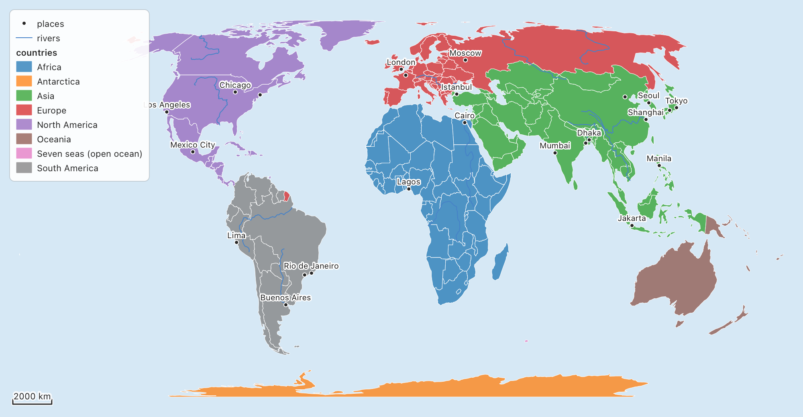
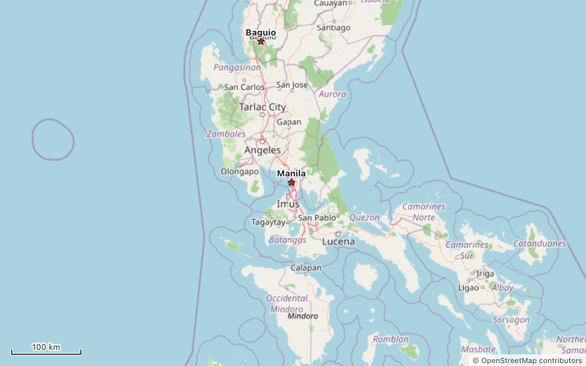
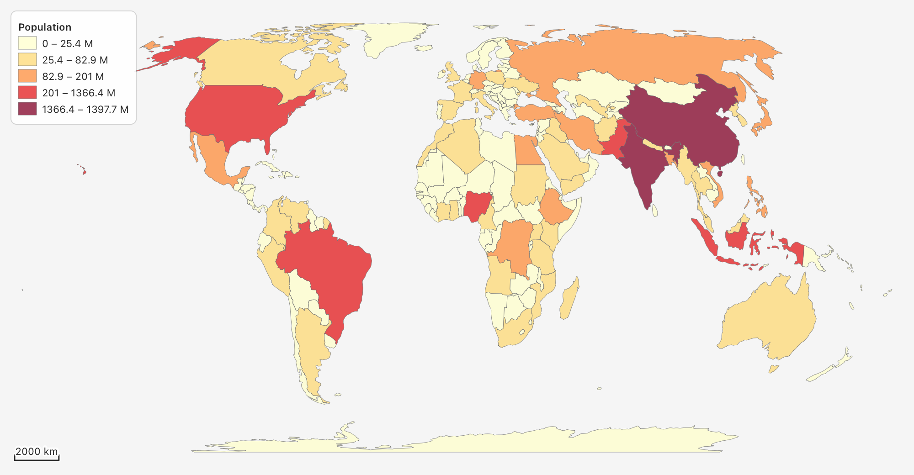
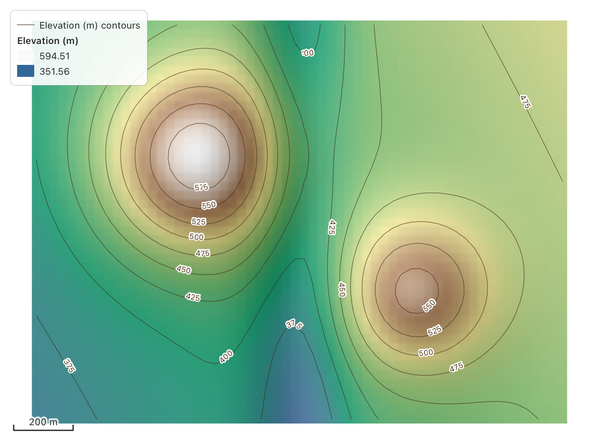

# cartography

Maps for [Tessel](https://tessel.syncster.dev) apps:

- vector layers with styles, labels and legends;
- basemap tiles (OpenStreetMap and other keyless sources) that work in any
  coordinate system;
- rasters with color ramps, hillshade and contours;
- GeoJSON, Shapefile, GeoPackage, KML, GPX, CSV, WKT/WKB and GeoTIFF files.

There's a ready-made `MapView` for apps. You can also draw a `Map` on a
Canvas of your own.



```sh
tessel add cartography
```

It uses [geodesy](https://geodesy-package.syncster.dev) for coordinate
systems and [viewport](https://viewport-package.syncster.dev) for panning and
zooming. `tessel add` brings both in. To call them yourself (`geodesy.epsg(…)`),
add them to your project too.

## A map in an app

```tessel
import cartography

fn startingMap() -> cartography.Map {
    var m = cartography.Map()                       // Web Mercator, unless you give it a crs
    m.add(cartography.openStreetMap())
    if let layers = cartography.readLayers("parcels.gpkg").value() {
        for layer in layers {
            m.add(layer)                            // reprojected into the map's system
        }
    }
    m
}

app Parcels(title: "Parcels", width: 900, height: 600) {
    state m = startingMap()
    state picked = ""

    VStack(spacing: 0) {
        cartography.MapView(map: m, legend: true) { hit in
            if let h = hit {
                picked = m.attributes(h).map { p in "{p.0}: {p.1}" }.joined(separator: ", ")
            }
        }
        Text(picked).padding(8)
    }
}
```

`MapView` handles the usual map controls:

- a drag pans, and the wheel or a pinch zooms about the mouse;
- a double click fits the map, and Shift with a drag zooms into a box;
- `+`, `−` and `⤢` buttons zoom in, zoom out and fit;
- clicking a feature selects it and hands it to your block;
- the scale bar is on by default, and the north arrow and legend are options;
- tiles download as you move.

Its parameters are `scaleBar`, `zoomButtons`, `northArrow`, `legend`,
`imperial` (feet and miles), `selects`, `keys` (arrows and +/− keys), and
`onMouse` (gets the longitude and latitude under the mouse).



## The Map

A `Map` holds:

- `layers` (the first one is drawn at the bottom);
- `crs`, the system it's drawn in (a `geodesy.Crs`);
- `vp`, a `viewport.Viewport` saying which part shows. It pans, zooms,
  turns and moves smoothly.

| | |
|---|---|
| `add(layer)`, `insert(_:at:)`, `remove(at:)`, `move(from:to:)`, `layerIndex(named:)` | Layers. `add` reprojects into the map's system. |
| `refresh(i)`, `refreshAll()` | Call after changing a layer's shapes, values, style or labels. |
| `setCrs(c)` | Draws the map in another system, keeping its place. Tiles are warped to fit. |
| `fit(box)`, `fitAll()`, `fitLayer(i)`, `centerOn(lon:lat:scale:)` | Where the map looks. |
| `scaleDenominator()`, `setScaleDenominator(n)` | The scale 1:N (96 points to the inch), measured on the ground. |
| `toLonLat(sx, sy)`, `fromLonLat(lon, lat)`, `toMap`, `toScreen`, `visible()` | Moving between the screen and the map. |
| `featuresAt(sx, sy)`, `featureAt`, `featuresIn(layer:x1:y1:x2:y2:)`, `attributes(hit)` | Finding features. |
| `select(layer:rows:)`, `clearSelection()` | Selections, drawn in yellow. |
| `draw(g)`, `savePicture(path, width:height:)` | Drawing it. |

To draw a map in your own Canvas instead of `MapView`, call
`m.vp.resize(w, h)` from `.onResize`, pass pointer events to
`m.vp.handle(e)`, call `m.draw(g)`, and add `drawLegend`, `drawMapScaleBar`
and `drawNorthArrow` where you want them. For tiles, call `fetchTiles` after
the view changes; the comment at the top of `tiles_fetch.tsl` shows how.

## Layers and styles

A vector layer has a `geomKind` (`.point`, `.line` or `.polygon`), one
`Geometry` and one row of `columns` for each feature, and a `crs`.

```tessel
var towns = cartography.Layer(name: "Towns", geomKind: .point)
towns.geoms = [cartography.pointGeometry(121.0, 14.6), cartography.pointGeometry(120.6, 16.4)]
towns.columns = [cartography.textColumn(name: "name", values: ["Manila", "Baguio"])]
towns.style.symbol = cartography.Symbol(fill: cartography.rgb(30, 90, 200), size: 10, marker: .star)
towns.labels = cartography.LabelStyle(enabled: true, field: "name")
m.add(towns)
```

- **Symbols:**
  - markers: circle, square, triangle, diamond, cross, x, star, pentagon,
    hexagon or arrow, or a PNG/JPEG/SVG picture;
  - lines: dashes, a casing and arrow heads, with markers along them if
    you like;
  - polygons: a solid fill or one of six hatches.
  - Sizes and turns can also come from fields.
- **Styles:**
  - `categorizedStyle(layer:field:)` gives one class per value.
  - `graduatedStyle(layer:field:mode:count:ramp:)` makes classes by equal
    intervals, quantiles, natural breaks (Jenks) or pretty breaks.
  - Color ramps include Viridis, Magma, Turbo, Blues, YlOrRd, RdYlGn,
    Spectral, Terrain and more (`rampNames()`).
- **Labels:** where there's room, with halos. They sit above, below or
  beside points, run along lines (or bend along them with `curved`), sit
  inside polygons, and can wrap, have a box behind them, and show only
  between two scales.
- **Filters:** set `hidden` to leave features out of the drawing and out of
  searches.
- **Scales:** `minScale` and `maxScale` limit when a layer shows.



## Files

`readLayers(path)` reads any supported file by its extension.
`writeLayer(layer, path)` writes a vector layer.

| Format | Read | Write |
|---|---|---|
| GeoJSON (`.geojson`, `.json`) | `readGeoJSON(text)` | `geoJSON(layer)` (WGS 84) |
| Shapefile (`.shp` + `.dbf`, `.shx`, `.prj`, `.cpg`) | `readShapefile(path)` | `writeShapefile(layer, path)` |
| GeoPackage (`.gpkg`) | `readGeoPackage(path)` | `writeGeoPackage(layers, path)` |
| KML | `readKML(text)` | `kml(layer)` |
| GPX (waypoints, routes, tracks) | `readGPX(text)` | `gpx(layers)` |
| CSV (x/y or WKT columns, guessed) | `readCSV(text, x:y:wkt:crs:)` | `csv(layer)` |
| WKT / WKB | `geometryFromWkt`, `readWKT`, `geometryFromWkb` | `wkt(g)`, `wktLines(layer)`, `wkb(g)` |
| GeoTIFF | `readGeoTIFF(path)` | `writeGeoTIFF(layer, path)` |
| ESRI ASCII grid, SRTM `.hgt`, PNG/JPEG + world file | `readAsciiGrid`, `readHGT`, `readWorldPicture` | `writeAsciiGrid` |

- **How results come back:** readers give `Result`s with errors that say
  what's wrong, and writers give `Error?`.
- **Several layers from one file:** a file with several kinds of shape gives
  one layer per kind.
- **Coordinate systems:** layers keep their file's system (from `.prj`, a
  GeoPackage's `srs_id` or GeoTIFF keys), and `Map.add` reprojects them.
- **GeoTIFF support:** strips and tiles; no compression, LZW, Deflate or
  PackBits; 8 to 64 bits, integer or float; several bands; no-data values.

## Rasters

```tessel
if let read = cartography.readRaster("dem.tif").value() {
    var dem = read
    dem.rasterStyle = cartography.rampRasterStyle(dem, ramp: "Terrain")
    dem.opacity = 0.75                              // the hills show through
    m.add(cartography.hillshade(dem))
    m.add(dem)
    m.add(cartography.contours(dem, interval: 25))
}
```

- **Looks:** gray, ramp (named or your own colors, in steps or smooth, with
  gamma and invert), hillshade, or RGB from three bands.
- **Coordinate systems:** a raster in another system is warped into the
  map's.
- **Terrain:** `hillshade`, `slope` and `aspect` follow gdaldem (Horn's
  method). `contours` gives a line layer with an `elev` column.
- **Values:** `rasterValue` gives a cell's value at a map point. There are
  also `rasterStatistics`, `rasterHistogram`, `sampleRaster` and
  `zonalStatistics`.



## Basemap tiles

- **Sources:**
  - `openStreetMap()`;
  - `tileLayer(s)` for any of `tileSources()`: OSM, OSM Humanitarian,
    OpenTopoMap, CARTO Positron, Dark Matter and Voyager, Esri imagery,
    street and topo, and USGS;
  - `xyzLayer(url:…)` for any `{z}/{x}/{y}` address;
  - `wmsLayer(service:layers:)` for WMS.
- **Attribution:** each layer carries its source's attribution, and the map
  shows it in the corner.
- **Downloads:** tiles download a few at a time with a User-Agent naming
  the library, as OpenStreetMap's tile usage policy asks. They are kept in
  `Map.tileFolder` (a temporary folder unless you set one).
- **Other coordinate systems:** a map not in Web Mercator gets its tiles
  warped into its own system.
- **Your app's responsibility:** a busy app should use its own tile server
  or a paid service. OpenStreetMap's servers are for light use.

## Coordinate systems

A map can be drawn in any system geodesy knows: EPSG codes, PROJ strings or
WKT (`geodesy.epsg(32651)`, `geodesy.crs("+proj=…")`). `webMercator()` and
`lonLat()` are the two common ones. `transformCoords` and `reprojected` move
coordinates and shapes between systems.

## Tests and examples

- `tessel test tests` runs 138 tests: the core, plus each part checked
  against an outside oracle.
  - **Formats:** GDAL through pyogrio, and shapely.
  - **Tiles:** mercantile.
  - **Rasters:** GDAL through rasterio, gdaldem and contourpy.
- `tools/oracle/` holds the generators that make the expected values. They
  need a Python venv in `.venv/` with `pyogrio shapely pyproj mercantile
  rasterio numpy contourpy matplotlib`.
- `tessel run examples` opens a small app.
- `tessel run examples/pictures` draws the pictures above.

## License

MIT. Map data in the examples is from [Natural Earth](https://www.naturalearthdata.com)
(public domain). The basemap picture is © OpenStreetMap contributors.
